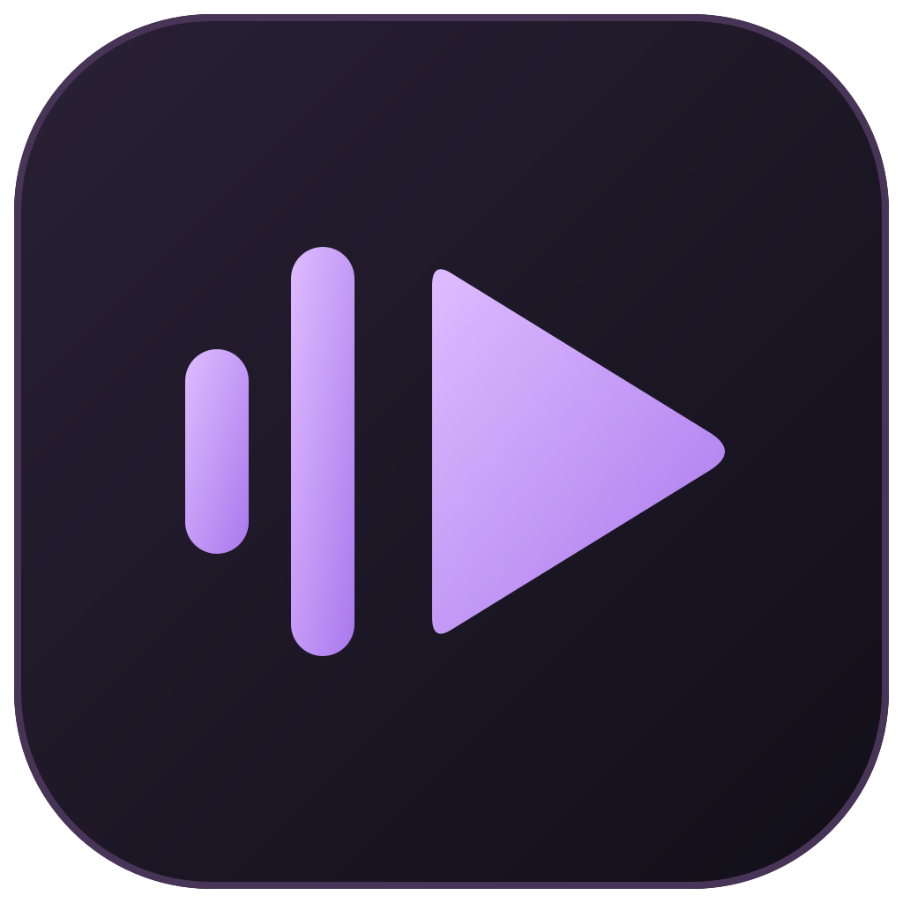
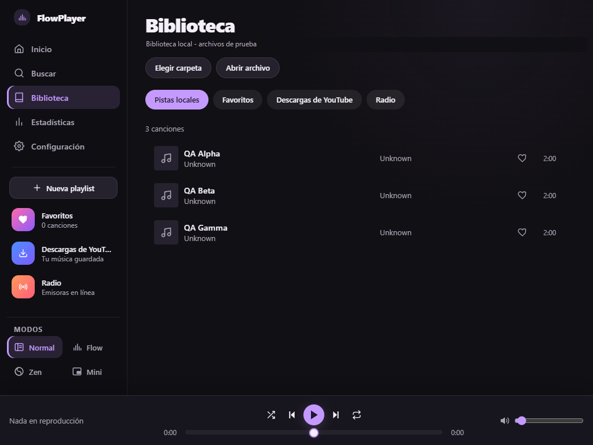
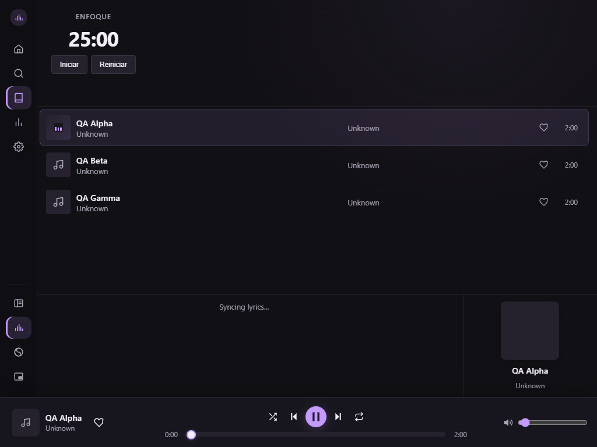
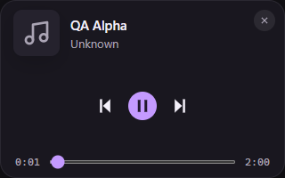

<div align="center">
  
  <h1>FlowPlayer</h1>
  <p>Tu biblioteca, YouTube y radio en escritorio, con adaptación Android de prueba.</p>
  <p>
    <a href="https://fabiangallardo-coder.github.io/reproducto_mpn/">Sitio web</a> ·
    <a href="docs/wiki/Primeros-pasos.md">Primeros pasos</a> ·
    <a href="https://github.com/FabianGallardo-coder/reproducto_mpn/wiki">Wiki</a> ·
    <a href="docs/wiki/Desarrollo.md">Desarrollo</a> ·
    <a href="https://github.com/FabianGallardo-coder/reproducto_mpn/issues">Reportar un problema</a>
  </p>
</div>

FlowPlayer reúne música local, radio por Internet y el reproductor oficial de YouTube en una interfaz oscura con acentos violetas. Está construido con Tauri 2, Rust y React.



## Descargar v0.1.1 candidata

[Release y archivos de descarga](https://github.com/FabianGallardo-coder/reproducto_mpn/releases/tag/v0.1.1): instaladores **Windows x64** (EXE/MSI), APK **Android 8+ ARM64** release firmado y checksums SHA256.

Es una **prerelease**, no una versión final estable. Windows requiere WebView2; sus instaladores no tienen firma Authenticode. El APK no puede actualizar una instalación debug con distinta firma: respaldá los datos importantes antes de desinstalarla.

## Qué podés hacer

Las funciones siguientes describen la versión de escritorio. Android tiene un backend y un alcance propios, detallados más abajo.

- Explorar archivos locales, marcar favoritos y crear playlists.
- Buscar en la biblioteca, en YouTube o entre las emisoras disponibles.
- Reproducir YouTube en un video flotante o acoplado a **Reproduciendo**, con cola y autoplay.
- Guardar descargas de material propio o autorizado y escucharlas sin conexión.
- Escuchar radio con 92 emisoras incluidas (SomaFM y listado argentino), agregar emisoras y consultar letras cuando están disponibles.
- Consultar historial y estadísticas de 7 días, 30 días o todo el historial guardado.
- Personalizar el acento y elegir el modo de inicio.

### Cuatro modos

| Modo | Uso |
|---|---|
| **Normal** | Biblioteca, páginas y controles persistentes. |
| **Flow** | Lista de pistas, Pomodoro, visualizador y letras. Los accesos laterales abren la página elegida en Normal sin detener la música. |
| **Zen** | Visualizador y controles esenciales. Escape vuelve a Normal. |
| **Mini** | Tarjeta compacta y opaca con transporte y progreso. |

YouTube utiliza un iframe visible: no se extrae audio para reproducir ni se evaden anuncios o restricciones. Entrar en Zen o Mini pausa el video porque esos modos no tienen espacio para mostrarlo.

<details>
<summary>Ver Flow y Mini</summary>





Las capturas proceden de una sesión de QA con archivos originales silenciosos, no de una biblioteca personal. Se ocultó la ruta local del equipo.
</details>

## Ejecutar en Windows

La validación nativa actual se realizó en Windows con WebView2. macOS y Linux necesitan validación adicional; no se ofrecen aquí garantías de compatibilidad ni cifras de rendimiento sin medir.

Requisitos:

- Node.js 22 o superior y npm.
- Rust estable con el toolchain MSVC.
- Visual Studio Build Tools con la carga de trabajo de C++ y Windows SDK.
- Microsoft Edge WebView2 Runtime.
- Git.

```powershell
git clone https://github.com/FabianGallardo-coder/reproducto_mpn.git
Set-Location reproducto_mpn
npm ci
npm run tauri dev
```

En **Configuración**, elegí tu carpeta de música. Para YouTube o radio hace falta conexión. La búsqueda y las descargas de YouTube usan el ejecutable `yt-dlp` configurado como sidecar.

El servidor Vite por sí solo no reemplaza la app de escritorio: necesita el puente IPC de Tauri. GitHub Pages presenta el proyecto y su documentación, no ejecuta el reproductor.

## Android: adaptación de prueba

La candidata **v0.1.1** incluye un APK release firmado para **Android 8 o superior**, solo **ARM64**, junto con instaladores Windows x64. Los paquetes se ofrecen como prerelease, no como versión final estable.

| Función | Estado Android |
|---|---|
| Archivos locales | Selector nativo de carpetas/archivos con permisos persistentes y URI `content://`. Un audio ilegible se omite con aviso sin descartar los válidos. |
| Reproducción | Motor Media3 con cola, pausa, seek, siguiente/anterior, aleatorio y repetición. Servicio multimedia para audio local y radio en segundo plano. |
| Biblioteca | Favoritos, playlists, preferencias e historial locales. |
| YouTube | Abrir enlaces desde Buscar; iframe oficial visible, flotante o acoplado. Se pausa al ocultar la app o entrar en Zen. |
| Búsqueda y descargas de YouTube | No disponibles. La búsqueda integrada requiere una futura integración con la API oficial. |
| Letras y visualizador | No disponibles; la interfaz lo indica. |
| Modos | Normal y Zen dentro de la app. Flow y Mini son exclusivos de escritorio. Zen mantiene los controles táctiles visibles. |

Se revisó el APK en un teléfono Android real: selección de documentos, portadas, scroll táctil de Biblioteca, búsqueda de Mitre/Cadena 3, filtros y reproductor oficial de YouTube. El release firmado se instaló con autorización; el usuario confirmó reproducción audible y pausa/reanudación. Las regresiones de navegador verifican cuatro tamaños, incluido horizontal; no sustituyen pruebas en otros teléfonos. No se certifican todas las emisoras, notificaciones, audio focus ni pantalla bloqueada.

Para compilar e instalar una APK propia, seguí [Desarrollo](docs/wiki/Desarrollo.md) y [Primeros pasos](docs/wiki/Primeros-pasos.md).

## Documentación

| Guía | Contenido |
|---|---|
| [Primeros pasos](docs/wiki/Primeros-pasos.md) | Preparar el equipo y reproducir la primera pista. |
| [Biblioteca y playlists](docs/wiki/Biblioteca-y-playlists.md) | Archivos, favoritos, colecciones y búsquedas. |
| [YouTube y radio](docs/wiki/YouTube-y-radio.md) | Video, descargas, emisoras y restricciones. |
| [Modos y atajos](docs/wiki/Modos-y-atajos.md) | Ventanas, Pomodoro y teclado. |
| [Configuración y datos](docs/wiki/Configuracion-y-datos.md) | Preferencias, almacenamiento y respaldos. |
| [Desarrollo](docs/wiki/Desarrollo.md) | Arquitectura, comandos, iconos y empaquetado. |
| [QA](docs/wiki/QA.md) | Pruebas simuladas, Tauri real y controles manuales. |
| [Solución de problemas](docs/wiki/Solucion-de-problemas.md) | Audio, YouTube, archivos y errores frecuentes. |
| [Publicación](docs/wiki/Publicacion.md) | Wiki y sitio GitHub Pages. |

## Verificar cambios

```powershell
npm run typecheck
npm run typecheck:qa
npm run lint
npm test
npx playwright install chromium
npm run test:e2e
cargo test --manifest-path src-tauri\Cargo.toml
cargo clippy --manifest-path src-tauri\Cargo.toml -- -D warnings
```

La suite de navegador simula Tauri y YouTube. Para comprobar reproducción y persistencia reales, seguí la [guía de QA nativo](docs/wiki/QA.md). Los diálogos del sistema, la audibilidad, los controles multimedia y el instalador requieren comprobaciones manuales.

Para empaquetar:

```powershell
npm run tauri build
```

Los instaladores se generan en `src-tauri\target\release\bundle`. Crear un paquete no equivale a certificar su reproducción de YouTube: también hay que probar el origen y la política CSP del paquete instalado.

## Contribuir

Abrí un issue con los pasos para reproducir el problema, el modo de ventana, la versión y una captura sin datos personales. Para cambios de código, usá una rama propia y enviá un pull request con las verificaciones realizadas. No incluyas cachés, reportes temporales, credenciales ni archivos de música.

## Licencia y componentes

El repositorio no incluye actualmente un archivo `LICENSE`; no se declara una licencia de distribución para el proyecto hasta que su titular la establezca.

Las dependencias conservan sus propias licencias. Entre los componentes utilizados están Tauri, React, rodio, Symphonia, lofty, reqwest, yt-dlp y AndroidX Media3. La interfaz toma referencias de Limusic y Valentine, sin afirmar afiliación con esos proyectos. YouTube es un servicio externo y sus restricciones siguen siendo aplicables.
